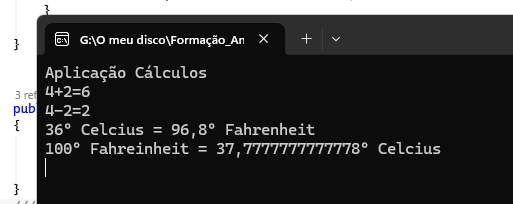

# calculos :1234:

Aplicação C# para efetuar diversos tipos de cálculos

Esta aplicação foi desenvolvida no *âmbito* da **_ação_** de formação à **introdução do Git e GitHub**

## Operações suportadas
Neste moento esta aplicação implementa as seguintes operações:

- Soma
- Subtração
- Conversão de temperaturas
    - Celcius :arrow_right: fahrenheit
    - farenheit :arrow_right: cwlcius

## Tecnologias utilizadas
- Visual Studio
- C#
- Git
- Github Desktop
- Plataforma GitHub

## Site Oficial
Faça donwload detsa aplicação no site oficial: [www.calculos.com](https://calculos.com)

